# Jali-Vulkan

C++17 voice-to-face engine with **native Vulkan morphing/skinning and rasterization**, plus a connected **local CPU neural-speech / detailed WebGL face studio**. These are separate rendering paths sharing verified neural WAV/cue sessions: **the detailed textured human now also renders in native Vulkan**.

## Brow and full-blink follow-up — actual WebGL renders

| Male — updated brows | Female — updated brows |
|:---:|:---:|
| 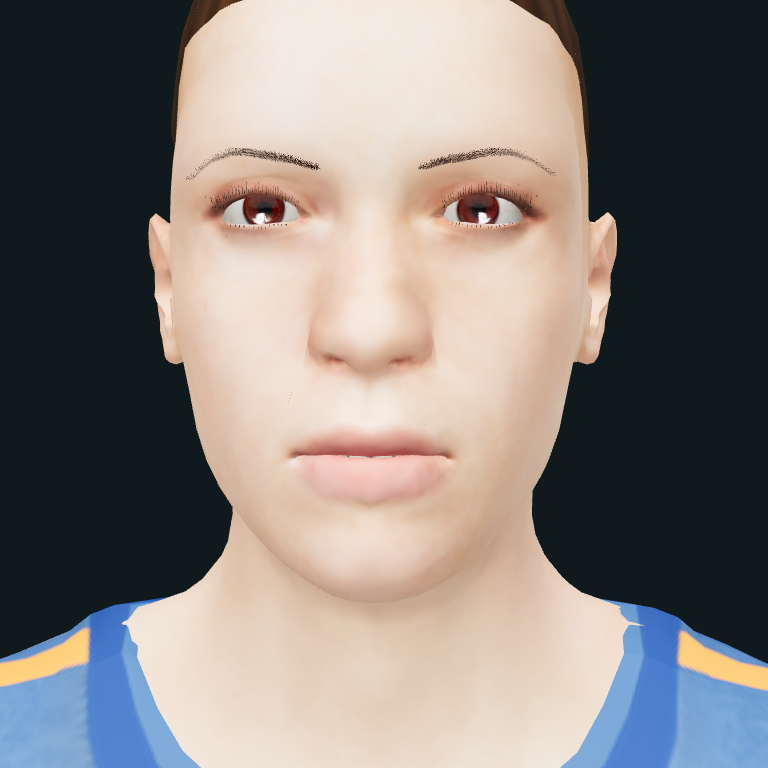 | 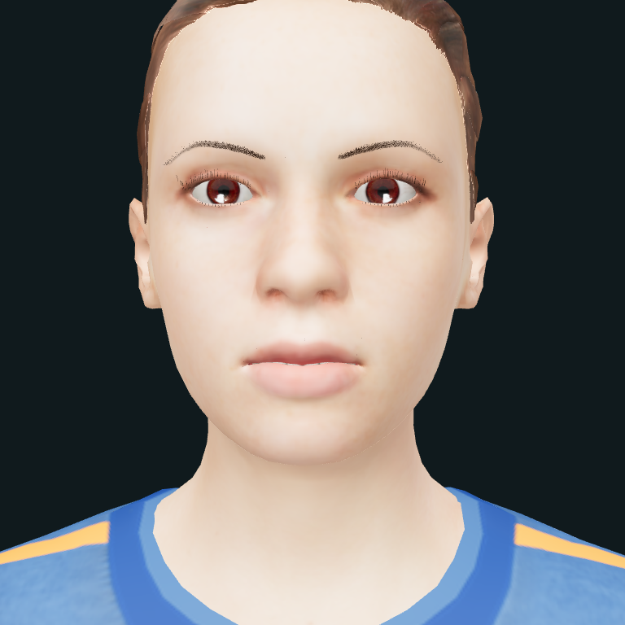 |
| 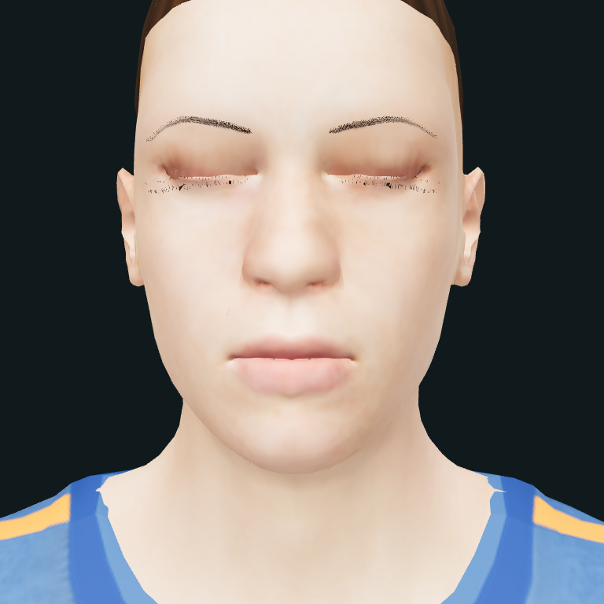 | 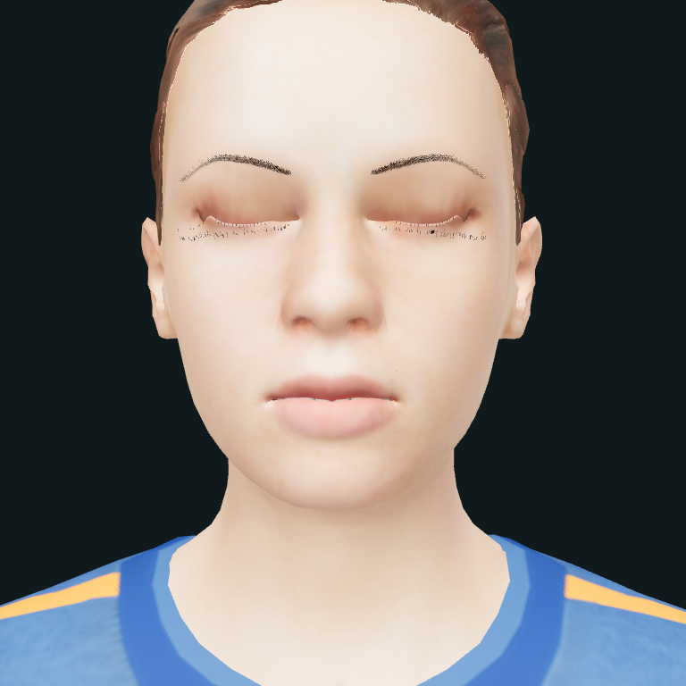 |

Both-sex surface-projected brow flow/density and separate bounded eyelid correctives
are implemented. The original 66 face controls/rest data are retained; the enhanced
rig adds two corrective channels. **Not final artistic approval:** pale lid margins,
lash/brow stylization and unreviewed contact remain. A 1 mm frontal geometry audit
improves female exposed samples **214→0/1,924**, male **242→0/1,924**; this shared-helper
sample audit is **not independent review or proof of gap-free pixels at every view**.

**Fresh actual CPU-speech previews for these new rig/viewer bytes:**
[male, am_michael](docs/media/brow-blink-male-talking.mp4) ·
[female, af_heart](docs/media/brow-blink-female-talking.mp4).
Both say “Mama brought five blue bags.” New synthesis and decoded 512px/15fps fixed-WAV-clock videos;
not camera-recorded AV or independent articulation truth.

Local **162 Python / 54 JS** pass; 32 held-pose frames cover both LODs/sexes,
unilateral/half/full blink, gaze and quarter view. Contact landmark intake now
measures actual skinned/morphed points against **externally declared** ranges.
**No genuine independent contact reference or physical camera/mic recording has
been supplied.** Actual i5-U/16GB/thermal and personal install/recovery acceptance
also remain open. Enhanced appearance is **WebGL-only**, not a silent native port.

**Current runtime CI: all 12 core + 1 male Windows jobs passed**, including the rebuilt enhanced EXE/selector and unsigned installer tests. [Completed source-bound receipt](docs/evidence/brow-blink-contact-actions.json). Binaries are deliberately not publicly uploaded; personal build instructions remain separate.

[Changes, limits, contact picking/intake, physical recording requirements and evidence](docs/contact-and-blink-review.md).

## Experimental v4 WebGL appearance and cross-tab ownership

| Male — actual neutral render | Female — actual neutral render |
|:---:|:---:|
| 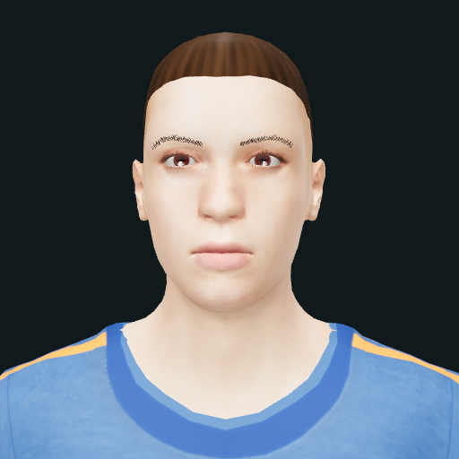 | 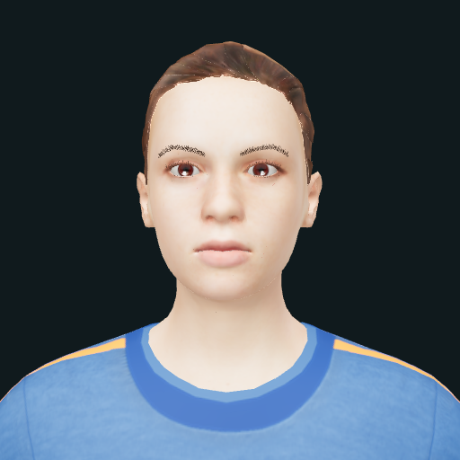 |

These are **held diagnostic poses, not newly validated speech/contact references**.
**Historical v4 talking previews (before the brow/blink follow-up above):** [male, am_michael](docs/media/realism-v4-male-talking.mp4) · [female, af_heart](docs/media/realism-v4-female-talking.mp4). Both say “Mama brought five blue bags.” using freshly synthesized, hash-bound local WAV/cues; offline 512px/15fps captures, not physical AV or perceptual approval.

Optional build-time skin normal/roughness maps, brow/lash ribbons and distinct male
short hair are implemented. Generated microdetail is **not scanned skin**, the hair
shell is **not a strand groom**, and opt-in thin-skin wrap (default off) is **not true
SSS**. These historical v4 full-blink renders showed gaps; the bounded
corrective follow-up above reduces sampled exposure, but artistic/eyelid/contact
approval remains open. The enhanced pair is WebGL-only; stock/native assets stay separate.

Live tabs now acquire an exclusive Web Lock **before renderer creation or model
fetch/decode**. Other tabs on that origin/browser profile wait; unload/close hands
over ownership. This is not a cross-profile/app/port or whole-PC memory cap.
Close/reload old build tabs after an upgrade. Exact-WAV independent-reference intake
and a private physical-camera AV probe/analyzer are available, but **no genuine
independent annotation or physical laptop recording has been accepted**.

[Build, tests, performance scope, remaining defects and reference/recording commands](docs/realism-v4-and-reference-validation.md).

## Actual renderer captures

These are real application exports, **not AI-generated illustrations or mockups**.
The human poses below follow estimated cues from freshly synthesized local speech.

| P/B/M closure — WebGL | F/V contact pose — WebGL | OO/W rounding — WebGL |
|:---:|:---:|:---:|
| 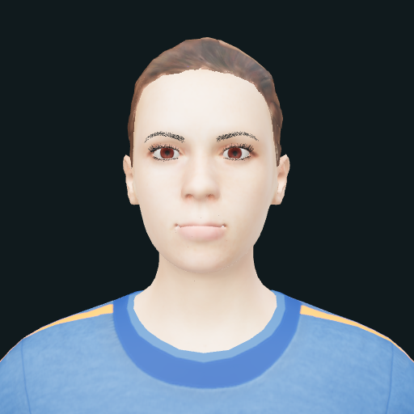 | 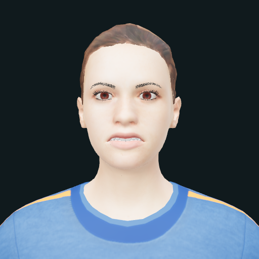 | 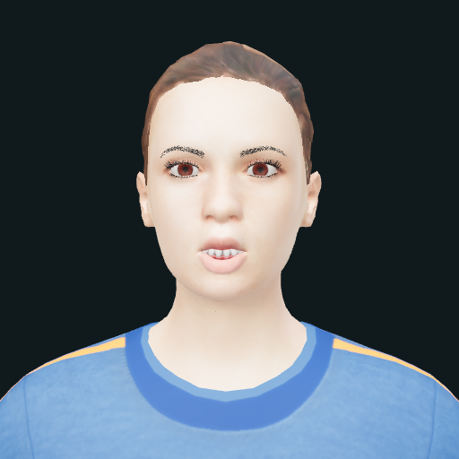 |

**Detailed human — actual native Vulkan raster output:**

| P/B/M closure — Vulkan | F/V contact — Vulkan | OO/W rounding — Vulkan |
|:---:|:---:|:---:|
|  | 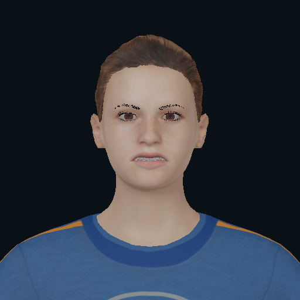 | 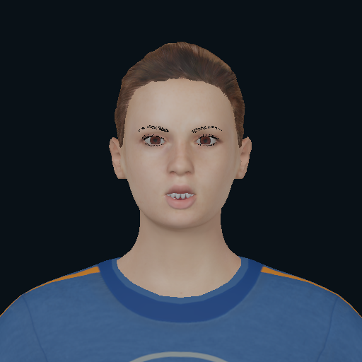 |

These use the **same actual neural WAV/cue contract**, not eSpeak retiming or a
prerendered replacement. Eight mesh groups, 53,116 vertices, 66 named facial
targets, 68 palette nodes and seven textured materials are preserved. Captured on
**SwiftShader software Vulkan**, not a hardware-GPU performance result.
[Exact image/audio hashes and deformation/browser evidence](docs/images/native-human-evidence.json).

**Native Vulkan — original android, 67-joint test fixture:**

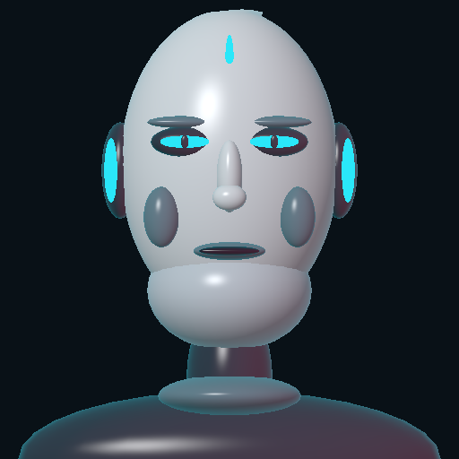

Captured on **SwiftShader software Vulkan**, not a hardware-GPU performance result.
The native fixture is not the detailed human above. [Capture commands, provenance,
image hashes and scope](docs/render-captures.md) are retained.

### Male/female selector and dedicated male Windows acceptance — 2026-10-17

A paired studio now switches between the two prepared models by **explicitly
unloading the old renderer/audio and navigating to a fresh document**. One model
per page; a shared CPU slot prevents simultaneous male/female generation. Close
other tabs to control total browser memory. Profiles, tokens, recordings and
saved conversations remain rig-isolated; no silent archive rebinding.

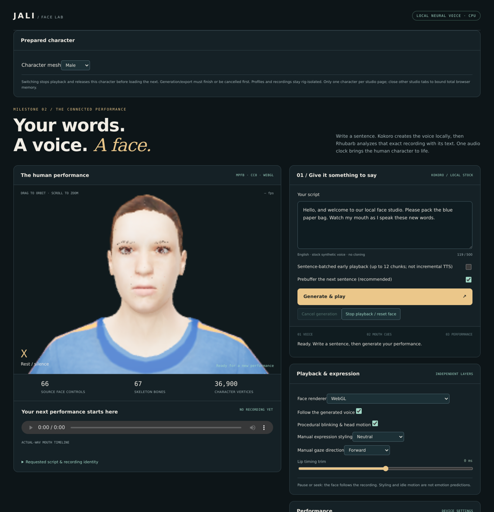

Personal build: `windows/build-character-pair.ps1 -PersonalUseOnly`.
[Commands, resource scope, all six requested areas and your laptop acceptance checklist](docs/character-selector-and-personal-acceptance.md).
Local **157 Python / 42 JS tests pass**; the selector browser fixture also passed.
**Dedicated male frozen EXE/paired selector/unsigned installer passed** in
[39024328601](https://github.com/Jacinth-19/Jali-Vulkan/actions/runs/39024328601),
with actual CPU speech and the requested male hash verified.
[Exact receipt and first failed installer attempt](docs/evidence/male-selector-windows-actions.json).
**All 12 stock/native regression jobs also passed** for the **same source `61e0315`** in
[39024328602](https://github.com/Jacinth-19/Jali-Vulkan/actions/runs/39024328602):
**12 core + 1 dedicated male job successful**. [Complete receipt](docs/evidence/character-selector-full-actions.json). New asset
realism, independent lip-sync/physical AV, actual i5 thermals and your PC's
install/recovery acceptance are **not** claimed complete.

### Reviewed mouth, lighting and brow/lash fixes — 2026-10-17

The first recommended fix batch adds depth-based oral lighting, less-white teeth,
less overpowering skin fill and lower-glint brown brow/lash response. No geometry,
speech weights or native appearance changes. **A lighting approximation—not new
mouth anatomy, true AO, scanned skin or a new groom.**

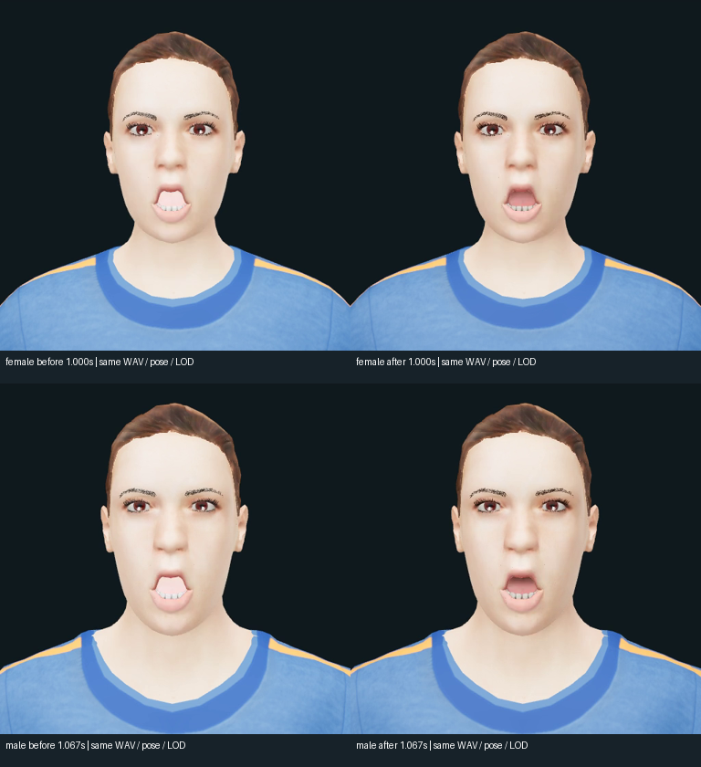

[Updated female talking movie](docs/media/makehuman-female-visual-fixes-talking.mp4) ·
[Updated male talking movie](docs/media/makehuman-male-visual-fixes-talking.mp4) ·
[Settings, exact same-WAV/pose/LOD proof and remaining limitations](docs/makehuman-visual-fixes.md).
Local **149 Python / 40 JS tests pass**; **all 12 hosted jobs passed** in
[39021296279](https://github.com/Jacinth-19/Jali-Vulkan/actions/runs/39021296279)
(source `60cb4f1`), including stock Windows frozen EXE/unsigned installer checks.
[Exact evidence, first failed run and corrected playback test](docs/evidence/makehuman-visual-fixes-actions.json). Mouth-corner/rounding, full-blink/F/V,
better source fibers/hair, human/physical-AV/i5 gates remain open. Existing PC EXEs
need rebuilding; back up rig-bound user data. Appearance/video stay WebGL-only.

### Male MakeHuman and skin for both characters — 2026-10-17

Added a **male MakeHuman variant using official gender shape targets**, retaining
speech/blink morphs and refitting the rig/eye pivots—not just changing a name or
voice. Both characters now share restrained physical skin highlights plus bounded
procedural micro-normal/roughness detail. Original textures, ponytail and outfit
are shared. **Not scanned skin, subsurface transport, Epic MetaHuman or final
realism approval.** [Setup, provenance, scope and EXE rebuild](docs/makehuman-male-skin.md).

| Female — actual WebGL | Male — actual WebGL |
|:---:|:---:|
| 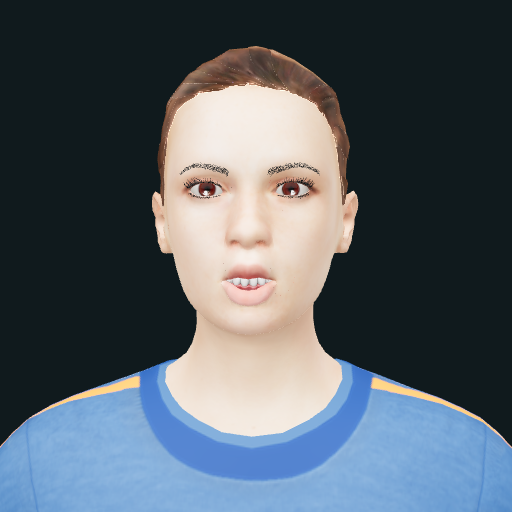 | 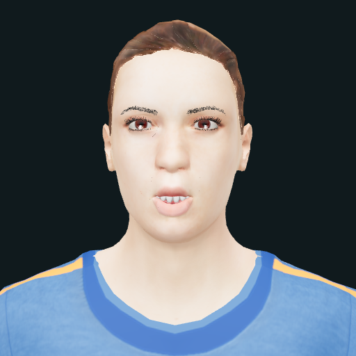 |

[Female talking video](docs/media/makehuman-female-skin-talking.mp4) ·
[Male talking video](docs/media/makehuman-male-skin-talking.mp4).
Local **146 Python / 37 JS tests pass**; **all 12 hosted jobs passed** in
[39017428466](https://github.com/Jacinth-19/Jali-Vulkan/actions/runs/39017428466)
(runtime `d78fc3b`), including male build/browser validation and the stock Windows
frozen EXE rebuild/clean-PATH execution/unsigned installer tests.
[Exact evidence and scope](docs/evidence/makehuman-skin-actions.json). Appearance/video stay WebGL-only.
Existing PC EXEs need rebuilding; back up rig-bound archives/profiles first.
Human review, physical AV and target-i5 measurements remain open.

**Earlier v2 visual review:** the older talking movies show a flat/bright mouth interior,
washed-out skin, coarse brows/lashes and a strip-like front hairline. Selected
P/B/M poses largely close; full blink and F/V contact are not established by these
clips. [Ranked findings and actual decoded-frame details](docs/makehuman-visual-review.md).

### Eye/hair materials and additional character — 2026-10-17

WebGL now has a wet dielectric eye coating and restrained anisotropic MakeHuman
hair-card shading. This is **not** strand-hair scattering or MetaHuman-quality
approval. An optional pinned Ready Player Me brunette sample can be prepared for
personal noncommercial use; no Epic MetaHuman assets were obtained.
[Repo review, character setup, real talking-video command and EXE rebuild](docs/eyes-hair-characters.md).
**143 Python / 36 JS** and **all 12 hosted jobs passed** in
[39003511599](https://github.com/Jacinth-19/Jali-Vulkan/actions/runs/39003511599)
(runtime `8af0695`), including the rebuilt/executed Windows frozen EXE and unsigned
installer. [Exact evidence and prior failure](docs/evidence/eye-hair-actions.json).
Old EXEs still need a local rebuild; keep backups of rig-bound profiles/archives.


[Watch the actual talking-face MP4](docs/media/makehuman-talking-preview.mp4) ·
[Render/WAV identity and scope](docs/evidence/eye-hair-preview.json).
Appearance/video remain WebGL-only; native retains calibration, authored
performance and weight timelines. Current Chrome is required for browser video.
Human quality, physical AV and measured i5 performance remain open.

### Character/workspace upgrades

Mapped self-contained GLB importing and reusable retarget profiles; prepared low
mesh/texture LOD and explicit unload; bounded multi-speaker paragraph/sentence
queues with durable verified WAV replay; an opt-in loopback command/event API;
and a personal unsigned per-user installer are implemented.
[Setup, API, supported rig contract and exact limits](docs/workspace-upgrades.md).
Local **142 Python / 33 JavaScript tests**, real-head workspace browser checks and
synthetic alias-map import pass. Actual Blender 4.0.2 round trips cover **16 poses /
all 13 required morphs**. Genuine two-voice dialogue and unsigned Windows
install/update/uninstall checks have passed. **All 12 hosted jobs passed** in
[run 38960192424](https://github.com/Jacinth-19/Jali-Vulkan/actions/runs/38960192424)
for implementation `1b527c0`; [exact evidence and prior failures](docs/evidence/workspace-upgrades-actions.json). Cast profiles persist
across launches and share one active prepared mesh and one inference worker;
this is not simultaneous multi-avatar rendering or universal rig importing.
**Public redistribution/licensing approval remains blocked**; signing is optional
for your personal version. Existing native render captures above are unchanged.

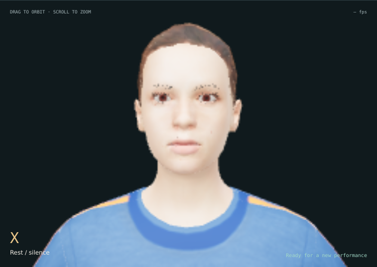

*Actual lower-detail WebGL render: 33,520 vertices / 37,842 triangles and 512px
textures. Screenshot captured at the low-resolution preset; not an articulation
or target-laptop frame-rate certification.*

### Creative upgrades (5–9)

Named per-character calibration profiles, optional natural eyes/idle, speech-safe
manual expression intensity and timed sequences, WebGL lighting/material/camera
controls with optional FXAA, and user-facing WebM + JSON/CSV animation exports are
implemented. [Usage and exact renderer/export limits](docs/creative-upgrades.md).
Local **132 Python / 31 JavaScript tests** and real-head browser/encoder checks
pass; **all 11 hosted jobs passed**, including Linux/Windows genuine speech and
the frozen app ([verified run](https://github.com/Jacinth-19/Jali-Vulkan/actions/runs/38945207804)). Manual controls are
not inferred emotion; video renders offline at fixed media-clock times as VP8/Opus
WebM, not MP4. Slow rendering takes longer instead of dropping frames.

### Four new studio upgrades

- **Low / Balanced / High** presets plus custom resolution/FPS and downloadable
  actual-playback observations. Starting points, not measured laptop profiles.
- **Clear / Baseline / Soft articulation**, with closure/contact/tongue and
  transition tuning shared by WebGL/native; human quality review remains open.
- **Verified next-audio prebuffer**, cancellation-safe cleanup and up to 1,000
  characters / 12 sentence chunks (still bounded, not guaranteed gapless).
- **Windows renderer/preset launcher**, free-port startup, owned-server Stop and
  actionable offline asset/native-device diagnostics.

Start after setup with **`windows/launch-studio.cmd`**. Rebuilt personal EXEs open
this chooser on double-click. [Controls, commands and exact limits](docs/four-upgrades.md) ·
[Actual upgraded studio screenshot](docs/images/studio-upgrades.png).
Upgrade checks: **130 Python / 22 JavaScript tests** and **all 11 hosted jobs passed**,
including real neural paragraphs, native resolution/calibration, and frozen Windows
GUI Launch/Stop/diagnostics. [Verified upgrade evidence](docs/evidence/four-upgrades-actions.json).
Laptop throughput and human articulation review remain open.

### Additional runtime hardening

- Windows native source-build/launcher path with pinned Vulkan loader sources;
  explicit software-only CI driver selection, never silent hardware substitution.
- Binary-safe native frame pipes on Windows and no 10,000-frame lifetime cutoff.
- Optional personal frozen-native bundle with relocatable shaders and system
  Vulkan driver selection; no driver is bundled.
- Personal package file manifests, offline `--verify-installation`, fail-closed
  startup and actionable local diagnostics. Integrity checks are **not signatures**.
- Cross-platform native longevity/stable-frame/resident-memory regression.

**All 11 hosted jobs passed**, including Windows native Vulkan and optional
frozen-native execution. [Exact verification evidence](docs/evidence/windows-native-integrity-actions.json).
[Windows native commands](docs/rich-vulkan-and-streaming.md#windows-native-source-build-and-longevity) ·
[Installation verification](docs/windows-portable.md#offline-installation-checks)

### Implemented next-stage features

- **Cancel generation:** stops the owned speech/analyzer child, hides partial media,
  cleans up, and allows a fresh request after the worker exits.
- **Stop playback / reset face:** clears stale audio, speech weights, styling and gaze;
  existing history can still be replayed.
- **Separate performance layers:** manual gaze, restrained head/blink motion, and
  neutral/warm/attentive styling. Speech closures, F/V and rounding take priority
  over warm smiles; these controls are not emotion inference.
- **Rich native Vulkan:** named position/normal morph storage, complete skin
  hierarchy, textured multi-material rendering, normal maps and alpha handling.
  CPU/GPU position/normal probes and all-vertex source Three.js comparisons pass.
  Select native presentation in the studio when its decoded backend is enabled.
- **Bounded sentence-batched early playback:** ordered, verified WAV/cue chunks,
  two-pending backpressure, sample offsets, cancellation/retry and a completed
  combined recording. **Not internal incremental Kokoro or gapless playback.**
- **Phone-level alignment diagnostics:** optional pinned two-pass PocketSphinx
  crosscheck of the actual WAV/transcript, explicitly not independent ground truth.
- **Personal Windows portable build:** unsigned CPU/WebGL app, optionally including
  native Vulkan, with no runtime Python/Node/gh requirement. Local-build-only pending redistribution/source
  compliance; hosted tests publish proof, **not the bundle or weights**.

**Prior baseline validated:** 123 Python tests, 17 JavaScript tests, 12 local native CTest
entries, actual CPU speech/batching, native/source/browser checks and native
longevity. **All 11 hosted Linux/Windows jobs passed** for source `caa1e95` in
[Actions run 38913502148](https://github.com/Jacinth-19/Jali-Vulkan/actions/runs/38913502148),
including detailed native Windows execution and the optional frozen-native app.
[Exact jobs, artifacts, failed attempts and scope](docs/evidence/windows-native-integrity-actions.json).
The earlier ten-job [rich/stream/CPU-package proof](docs/evidence/rich-stream-portable-actions.json)
remains historical evidence, not a substitute for the new native Windows tests.

### Windows native mode (after neural developer setup)

Requires CMake and free Visual Studio C++ x64 build tools / Windows SDK:

```powershell
.\windows\setup-native.ps1
.\windows\start-neural.ps1 -NativeVulkan
```

Select **Native Vulkan** in **Face renderer**. This uses your installed Vulkan
driver; hosted software tests do not prove your laptop's driver/performance.
For your own optional portable native build:

```powershell
.\windows\build-portable.ps1 -PersonalUseOnly -IncludeNativeVulkan
```

The bundle stays unsigned/personal; no GPU driver is bundled. See the
[build and installation-check guide](docs/windows-portable.md).

See [rich Vulkan, streaming and alignment usage/limits](docs/rich-vulkan-and-streaming.md)
and [personal Windows portable-build instructions](docs/windows-portable.md).
See [implementation details and remaining work](docs/performance-controls.md) and
[the milestone tracker](docs/project-tracker.md). The user reports that the Windows
command runs on their PC; quantitative target-laptop results have not been supplied.

## Run the native live demo here

Linux x86_64 / Python 3.11 sandbox:

```sh
python3 -m venv .venv
.venv/bin/python tools/bootstrap_sandbox.py
.venv/bin/python tools/preview_server.py --software-vulkan --port 8080
```

Open the port 8080 preview and press play, or enter text and select **Start live performance**. No video-encoding step is needed. The sandbox has no exposed hardware GPU: the UI truthfully reports **SwiftShader software Vulkan**.

On a hardware Vulkan machine, omit `--software-vulkan`. Use `--require-hardware` to reject software fallback. See [the live engine guide](docs/live-engine.md) for standard build instructions and remaining external requirements.

## Current capabilities

| Working and tested | Still blocked or outside scope |
|---|---|
| Real built-in eSpeak speech and phoneme timing events | Neural cloning needs an authorized reference and reviewed local weights |
| Lip closure, jaw opening, rounding, and short coarticulation | Learned facial solving / broader language-specific viseme sets |
| Detailed human: 53,116 vertices, 68 palette nodes, 66 named targets, textured multi-material profile | General FBX/Assimp/DCC rig compatibility and unrestricted glTF |
| GPU morph-then-skin compute pass + rasterized triangles | Hardware-GPU validation in this CPU-only sandbox |
| Persistent native renderer, Web Audio clock, live frame requests, pause/seek | Internal incremental neural inference, gapless batching and microphone conversation |
| CPU/GPU deformation comparison, malformed-asset tests, official glTF validation | Physical display/speaker sync certification and target-device p95 budgets |

A local Chatterbox provider entry point is available in `tools/authorized_voice.py`, with authorization/expiry/hash admission checks. **Chatterbox cloning inference is not installed, exercised, or connected to the preview here.** A separate local stock-voice Kokoro CPU experiment has now succeeded; see below. No human voice reference was supplied. Another voice's audio requires its own true alignment; eSpeak timings are not reused to fake alignment.

## Local stock neural speech — CPU checkpoint passed

Kokoro-82M v1.0 q8 now generates new speech locally with ONNX Runtime's CPU
provider, using the stock `af_heart` voice. Two new 24 kHz PCM16 WAVs were produced
and validated. This is not Arena `voice-00` or a clone. The new connected studio
now pairs newly generated audio with its own mouth cues and the human face. eSpeak NG supplies phonemization only; the waveform comes
from the neural ONNX model.

See [setup, measured results and license/provenance limits](docs/local-neural-speech.md)
and the [updated project tracker](docs/project-tracker.md). Use explicit model
setup followed by `tools/local_neural_speech.py`; generation has no hosted speech
fallback. The user reports a successful Windows PC run; no target-device benchmark report has been reviewed.

## Connected neural face studio — M2 prototype delivered

**New text → local Kokoro CPU speech → analyze that WAV with its script → human
WebGL face**, through one Generate & play action. No prerecorded speech or earlier
recording's timing is substituted. Each session carries audio/text hashes, cue
provenance and a versioned rig identity; the browser also verifies the WAV hash.

See [setup, protocol, evidence and limitations](docs/neural-studio.md).
After explicit model/dependency setup:

```sh
.venv/bin/python tools/build_neural_studio.py
.venv/bin/python tools/neural_studio_server.py --bind 0.0.0.0 --port 8082
```

The port 8082 preview offers new generation, play/pause/seek, six-session history,
WAV/cue/manifest downloads, cancellation, playback reset and manual expression/gaze controls. The Linux CPU/browser
pipeline passed two real form submissions plus fast contract tests. It completes
whole utterances before playback, uses estimated visemes, and does not claim
learned emotion, native support for this rig, or tested target-laptop performance.
This is a development service, not authenticated public hosting; do not enter
sensitive content. The Windows x64 developer backend now passed real CPU speech,
Windows audio analysis and live Chrome integration in [nine-job Actions run 38843451199](https://github.com/Jacinth-19/Jali-Vulkan/actions/runs/38843451199).
See [Windows developer setup and actual measurements](docs/windows-neural-studio.md).
An optional unsigned personal installer now passes hosted install/update/uninstall
checks; measured target-laptop acceptance remains open. See [current personal-build
setup and boundaries](docs/workspace-upgrades.md).

## Personal face and voice test assets

A downloadable CPU-first test pack is described in [test-pack.md](docs/test-pack.md).
It combines our original rigged GLB, a standalone offline-capable rig inspector,
three externally generated stock neural-voice references, and a separate actual
local eSpeak/Vulkan timing-baseline video. That earlier pack keeps the neural recordings separate from its manual rig
inspector; it remains available unchanged. Neither pack is a self-hosted neural
clone demonstration. Generated media stays under ignored `artifacts/`.

## Detailed human face driven by the existing clips (WebGL)

The new `web/neural-head/` viewer uses the **same three stock neural WAVs** to
animate a textured **CC0 MPFB/MakeHuman avatar**: 67 bones, 66 main-mesh face
controls, and matching teeth/tongue targets. CPU Rhubarb analyzes the actual WAVs
with their dialog; nine estimated mouth classes are retargeted with short
coarticulation. This is **approximate automatic viseme timing, not manually
verified phoneme forced alignment** or learned emotional facial solving.

The delivered ZIP opens offline by double-clicking `index.html`; a portable
H.264/AAC lip-closure example is included. No neural model or server is needed
to play it. See [the human-head guide](docs/human-head-demo.txt) for provenance,
license evidence, limitations and Windows playback instructions.

**This viewer uses Three.js/WebGL, separately from the native Vulkan demo.**
The strict native importer does not yet support this richer character. Target
Windows laptop speed has not been measured; software browser rendering here is
slow, so the 15 fps example video is rendered offline rather than a live-FPS claim.

Rebuild/test on the Linux developer setup after `npm ci --prefix tools` and
installing Pillow/imageio-ffmpeg in `.venv` (existing WAVs must be present):

```sh
.venv/bin/python tools/build_neural_head.py
.venv/bin/python -m http.server 8081 --bind 0.0.0.0 --directory artifacts/neural-head-demo
# In another terminal; exports the real clip-driven face as well as testing it:
EXPORT_VIDEO=1 node tools/smoke_neural_head.cjs
.venv/bin/python tools/build_neural_head.py --seal-only
# Fast tests, no downloaded character/recognizer or GPU needed:
node --test tests/visemes.test.mjs
python3 -m unittest discover -s tests
```

The build pins/verifies the source model and Rhubarb repack hashes, records each
recording's hash, retains explicit upstream per-model CC0 evidence, and validates
both compressed-container structure and decoded geometry. The official validator
reports zero errors and nine retained warnings on decoded geometry. Runtime
pruning reduces shader work to 20 used controls without deleting other controls
from the downloadable GLB. Rebuilding the analyzer does not regenerate speech.

## Build/test without native dependencies

CMake 3.16+, C++17 with `std::filesystem`, and Python 3.8+:

```sh
cmake -S . -B build -DCMAKE_BUILD_TYPE=Debug
cmake --build build --parallel
ctest --test-dir build --output-on-failure
```

This default path needs no third-party C++ libraries or Python packages. It tests deterministic mock audio/curves, rig contracts, phoneme mapping, HTTP contracts, and neural-provider admission rules without loading a neural model. On multi-configuration generators, use `--config Debug` and CTest `-C Debug`.

Optional native build (system Vulkan/eSpeak development files and tinygltf 2.9.3 checkout):

```sh
cmake -S . -B build-live -DCMAKE_BUILD_TYPE=Release \
  -DJALI_ENABLE_ESPEAK=ON -DJALI_ENABLE_VULKAN=ON \
  -DTINYGLTF_INCLUDE_DIR=/path/to/tinygltf-2.9.3
cmake --build build-live --parallel
ctest --test-dir build-live --output-on-failure
```

`glslangValidator` compiles the shaders. If it is unavailable, `npm ci --prefix tools` provides the pinned WASM shader compiler. It also provides the official glTF Validator and optional browser test tools.

GitHub Actions runs the GCC/Clang matrix, sanitizers, and native software-Vulkan/browser checks on pushes, PRs, or manual dispatch. Native artifacts include actual runner resource inventory, validation logs, and screenshots; software Vulkan is not hardware-GPU validation. A separate neural-studio job now runs actual Kokoro CPU inference, generated-WAV/dialog analysis and detailed-face browser review on this session branch or manual dispatch. [Hosted neural results and M3 scope](docs/neural-articulation.md) include the successful seven-job run and remaining quality gates. See [CI resource details](docs/live-engine.md#github-actions-resource-and-validation-runs).

GCC/Clang sanitizer builds: add `-DJALI_ENABLE_SANITIZERS=ON`. Core contracts need no models or private credentials. The opted-in neural job uses pinned public stock speech assets, never private voices or recordings.

## Documentation and layout

- **[Project tracker — completed work, remaining tasks and acceptance gates](docs/project-tracker.md)** — the ongoing eight-workstream checklist and agreed execution order.
- **[Live engine and remaining requirements](docs/live-engine.md)** — current architecture, supported GLB profile, hardware enforcement, measurements, neural adapter, and authorization schema.
- [Build dependencies and offline export](docs/running-demo.md) — platform packages, optional MP4 compatibility tool, licensing.
- [Architecture and milestones](docs/architecture.md) — original CPU baseline and larger engine roadmap.
- [Technical review](docs/technical-review.md) — source-backed corrections to the original report.

```text
include/jali/              Voice, phoneme, rig, character, renderer and QA contracts
src/                       CPU pipeline, eSpeak, GLB importer, Vulkan, CLI/live worker
shaders/                   GPU morph/skin, mesh rasterization, legacy analytic face
tools/make_character.py    Original GLB fixture authoring (no external face art)
tools/live_session.py      Bounded persistent native frame transport
web/                       Web Audio + native-frame presentation controls
tests/                     Contracts, malformed assets, GPU/CPU and HTTP tests
.github/workflows/ci.yml    CPU/sanitizer builds and native software-Vulkan checks
```

## Safety and distribution

The default preview uses only the disclosed built-in English synthetic voice. It has no public voice-upload/cloning endpoint. The private neural-provider CLI requires a reviewed grant/reference/model bundle; its manifest is not proof of legal consent. No commercial voices or human identities are silently substituted.

The preview is a **development server**, not an authenticated production service. It stores submitted text/audio locally, limits requests and retains bounded sessions; do not enter sensitive content. Generated media, binaries, models and datasets are ignored by Git. Third-party model code requires separate isolation and supply-chain review.

Optional eSpeak is GPL-3.0-or-later. tinygltf and all runtime/compiler/media dependencies retain their own licenses; wrapper package labels do not relicense bundled components. Review linked-executable obligations before distribution. This repository still has no owner-selected distribution license.

### Early Windows-browser checkpoint

The offline playback pack adds half-speed articulation review, per-recording notes
and explicit JSON export of visible-tab render observations. It requires no Python
or speech-model installation for playback. See [extraction and review instructions](docs/windows-playback-checkpoint.txt)
and [the eight-job Linux/Windows validation and remaining scope](docs/playback-checkpoint.md).
This is not a port of the local speech backend, a native Vulkan package, or a
performance claim for your Windows laptop.

### Generate new speech on Windows x64

With Python 3.11 x64, Node 22 and GitHub CLI public-source access installed, run
`windows/setup-neural.ps1` once, then `windows/start-neural.ps1`. Open the localhost
URL printed by the launcher. Setup is explicit/networked; generation is local CPU
with no hosted-speech fallback. These are developer scripts, not a standalone
installer. [Prerequisites, results and remaining limitations](docs/windows-neural-studio.md).

### One-command Windows benchmark

After explicit Windows setup, run `windows/benchmark.ps1`. It generates six new
public test recordings by default and writes model/import/generation/analysis
times, peak worker memory and visible-browser rendering observations to
`artifacts/jali-benchmark-report.json`. Nothing uploads automatically; inspect the
report before sharing. Independent-reference templates and a static native-rig
gap audit are included, not a completed quality score or Vulkan port.
[Commands, actual Windows CI evidence and remaining M3/M4 work](docs/windows-benchmark.md).
