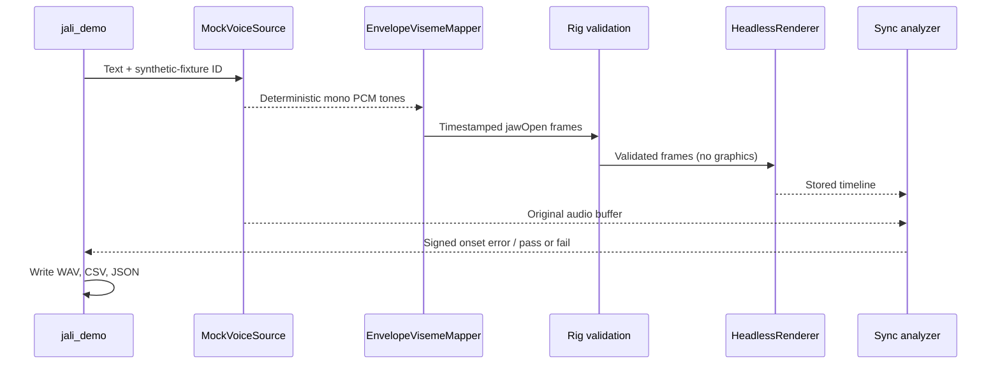
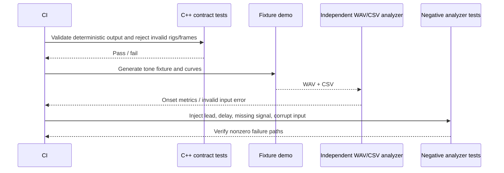

# Starter architecture and integration plan

## Current extension: live phonemes and imported GPU-skinned meshes

The current implementation includes timed eSpeak phonemes, a strict-profile GLB importer, Vulkan compute morphing/skinning plus rasterization, and live native-frame delivery driven by Web Audio. See [live-engine.md](live-engine.md) for exact run commands, import restrictions, validation evidence, hardware enforcement and unresolved neural-provider requirements.

The original CPU baseline and the broader engine roadmap below remain useful design context. Statements describing the old procedural renderer or offline preview are historical; they are not the current default UI path. General Assimp/FBX authoring compatibility, incremental neural streaming, target-GPU performance, and complete consented neural/forced-alignment integration remain separate work.

## CPU baseline

The CPU baseline above is synchronous and offline. The **mock** source generates tones, not speech. Text controls a bounded number of tone bursts (one to eight, using ASCII spaces); it does not undergo linguistic analysis. The baseline uses no audio device, face mesh deformation, Vulkan instance, network client, machine-learning model, capture device, Assimp dependency, or video output; optional real backends are separate targets.

The triangle fixture carries illustrative joint influences and one `jawOpen` channel. The headless sink validates and stores curves; it does not skin even this triangle. These limitations keep tests runnable on standard CPU-only CI without downloading models or requiring a Vulkan SDK.

## C++ contracts

Public definitions: [`include/jali/pipeline.hpp`](../include/jali/pipeline.hpp).

| Contract | Current implementation | Next adapter |
|---|---|---|
| `IVoiceSource::synthesize` | `MockVoiceSource`, synthetic tones only | Authorized local-worker or cloud TTS adapter |
| `IVisemeMapper::map` | `EnvelopeVisemeMapper`, RMS to jawOpen | Provider-aligned phoneme cues or a neural mapper |
| `Rig` / `validate_rig` | Bone parent/name, vertex, influence, and channel-range validation | Imported topology, inverse bind matrices, normals, morph deltas, and animation tracks |
| `FaceFrame` / `validate_frames` | Strictly increasing nonnegative times, finite and in-range weights, exact channel count | Rig-specific retargeting and full pose data |
| `IRenderer::submit` | `HeadlessRenderer`, copied validated frames | Vulkan renderer with actual GPU deformation |
| `analyze_sync` | Absolute onset-error gate, missing signal is an error | Actual device/render timestamps, multi-cue drift/quality tests |

`AudioBuffer` is mono float PCM in [-1,1], at a validated sample rate from 100 through 192,000 Hz. Its first sample defines time zero. `FaceFrame::audio_time_seconds` is on this same audio clock, **not wall time or a render-loop tick count**. Curves are generated at approximately 100 Hz; the final window may be partial. Envelope calculation reads a whole ~10 ms window and labels its start. This is an offline convention and entails lookahead in a future streaming implementation.

Morph array indices follow `Rig::morph_channels` order. The starter mapper, metrics, and artifact writer specifically use channel zero as normalized `jawOpen`. A replacement mapper must retarget named source channels to the destination order, not assume vendor channel layouts are identical. `validate_frames` supports rig-specific negative corrective-shape ranges; the onset metric is intentionally narrower and only accepts normalized jaw values.

Skin weights must be finite, nonnegative, and sum to one within `1e-4`. A maximum of four influences is a starter policy, not a glTF restriction. Parent indices may appear in any order, but must be valid and acyclic. Multiple root bones are allowed. Bone rotations and inverse bind matrices are not present and therefore are not validated yet. Geometry validation is not a complete asset-security audit.

Errors use C++ exceptions. Implementations are **not thread-safe** and must not be shared across threads without external synchronization. Inputs are caller-owned for the duration of each synchronous call; the headless renderer copies frames. These small fixture interfaces do not pretend to be complete low-latency streaming APIs.

## Artifact and QA contract

`jali_demo --output DIRECTORY` writes:

- `session.wav`: mono PCM16, little-endian RIFF/WAVE, original sample rate.
- `face.csv`: exact header `audio_time_seconds,jaw_open` and ordered rows.
- `metrics.json`: `fixture_only`, measured onset times, signed lag, and boolean result.

Files under the selected output directory are overwritten. Use a disposable directory and keep real recordings outside Git and public CI artifacts.

The C++ and Python analyzers independently compute approximately 10 ms RMS windows. Audio onset is the first window above 0.05 RMS; face onset is the first frame above 0.1 jaw opening. Positive error means the face lags audio. Both early and late motion beyond the tolerance fail. No audio activity or no mouth activity is **inconclusive/error**, never a passing sync result.

The Python CLI exits `0` for pass, `1` for measured threshold failure, and `2` for invalid or inconclusive input. The demo uses a fixed 100 ms tolerance and the same exit-code meanings. The analyzer validates the entire supplied curve file, including rows after onset, and rejects duplicate, nonfinite, negative, or out-of-duration timestamps. It accepts only uncompressed mono PCM16 WAV.

The two analyzers have tiny PCM quantization differences (float input versus serialized PCM16). The thresholds are chosen far from the fixture's active energy. Near-threshold production audio will need explicit calibration, VAD policy, and tolerances for windowing and quantization.

This is a software timing-contract gauntlet, **not a rendered lip-sync benchmark**. It has no independent semantic ground truth and does not prove full-utterance synchronization. A video-aware test must be added when there is a renderer.

## General imported-mesh Vulkan design — implemented subset and remaining work

1. `JALI_ENABLE_VULKAN` now builds the analytic compatibility renderer and a compute-skin/raster mesh renderer. The CPU-only tests remain available without the SDK.
2. Define a tested CPU reference for morph-then-skin deformation. Build palettes from animated global joint transforms, inverse bind matrices, and the appropriate mesh-local transform. Test normal/tangent handling and coordinate conversion; position-only agreement is insufficient.
3. Upload immutable rest geometry, indices, morph deltas, and influence data once. Stream only current palettes and active morph weights through frame-owned buffers. Confirm GPU struct alignment and matrix conventions with fixture tests.
4. Benchmark vertex deformation first. Add a compute path when reusing deformation across passes justifies its extra write/read bandwidth. Do not add mesh-shader extensions as a baseline requirement.
5. For compute output, create storage buffers with the additional usage bits needed by their consumers. Establish a compute shader write -> vertex attribute read dependency when binding the result as a vertex buffer, or -> vertex shader storage read when fetching through an SSBO. Synchronization2 can express this with `vkCmdPipelineBarrier2`; gate it on Vulkan 1.3 or the appropriate extension. Transfer uploads also need their own visibility dependencies.
6. Keep per-frame resources alive until their fences/timeline values complete. Handle noncoherent memory flushing and, for distinct queue families, queue ownership transfers plus semaphore dependencies. Double buffering alone is not a correctness guarantee.
7. Use SSBOs or suitably sized UBOs for bone palettes, not an assumed large push-constant block. Query device limits and align offsets. Validate descriptor ranges and avoid overwriting in-flight regions.
8. Ray-tracing acceleration-structure updates and GPU/CPU physics consumption are separate scheduled work, not automatic side effects of compute skinning.
9. Add Vulkan validation-layer checks and offscreen GPU-vs-CPU deformation/readback tests on a designated test machine. Later add an actual presentation-clock and captured-frame sync test.

## General asset interchange pipeline — beyond the implemented strict GLB profile

Prefer glTF/GLB runtime assets. Preserve a canonical consented DCC fixture and its rig schema. Pin the selected Assimp version, enumerate available exporter formats at runtime, and do not silently drop unsupported features.

Acceptance fixtures should contain skinning, hierarchy, inverse bind matrices, animated joint TRS, nonzero morph deltas, animated morph weights, normals/tangents, material references, and explicit units/coordinate conventions. Export, validate with Khronos glTF Validator, reload, and compare semantics and **deformed poses** within stated tolerances. An asset validator alone cannot verify visual deformation or exporter fidelity.

Test an asset with additional joint-weight sets and more than eight morph targets even if the starter runtime rejects the former. Document rejection or explicit offline reduction. Bake DCC constraints/controllers into supported tracks; never promise arbitrary procedural rig round-tripping. FBX support should be a separate fixture-backed capability, not a blanket compatibility claim.

## Streaming and authorization — partial implementation

The current eSpeak adapter still synthesizes whole utterances, but frame rendering is live and follows the browser audio clock. Neural admission checks are a separate operator CLI, not an enabled web cloning feature. Further incremental streaming requires:

- Chunks carry utterance ID, sequence number, sample rate, starting sample offset, and end-of-stream status. Validate ordering and define resampling explicitly.
- Use a bounded queue/ring buffer and a documented jitter/lookahead budget. The audio **playback sample cursor** is the master clock. Interpolate face curves for the displayed frame at that cursor, accounting for the presentation pipeline's latency.
- Inference and networking run off the render/audio callbacks. Define cancellation, backpressure, timeout, underrun, reconnection, and neutral-pose fallback. Never block a real-time audio callback on model inference or allocation.
- Every real speaker reference requires an authorization record checked at request time, independent of a vendor voice ID. Add revocation, permitted scope, disclosure, provenance, quotas, and retention before enabling capture or cloning.
- Benchmark first-playable-audio latency separately from steady-state throughput, lookahead, time-to-first-face-frame, device latency, and p95 rendered synchronization.

## Milestones and acceptance gates

Calendar estimates from the original report are not adopted: team size, model availability, consented assets, target GPU, and platform are not yet defined. The following are dependency-ordered deliverables.

| Milestone | Deliverable | Exit gate |
|---|---|---|
| **M0 — delivered** | Corrected review, C++ interfaces, synthetic fixture, rig checks, artifacts, CPU-only CI | Debug/release tests pass; invalid rigs, early/late motion, missing signals, and bad artifacts fail |
| **M0.5 — delivered** | Built-in eSpeak speech, procedural Vulkan compute face, offline MP4 playback UI | Real PCM/pixel readback and browser generation tests; still no imported-mesh skinning or streaming |
| **M1 — assets** | Pinned importer/exporter and canonical consented glTF character | Validator success and round-trip pose comparison; explicit unsupported-feature report |
| **M2 — partially delivered** | CPU reference + Vulkan compute morph/skin and rasterization for an imported GLB | CPU/GPU position agreement verified; validation layers and target hardware still need execution |
| **M3 — partially delivered** | Built-in TTS phonemes, persistent renderer and Web Audio live playback | Browser pause/seek/live frames verified; incremental neural audio and physical AV timing are not established |
| **M4 — fidelity and scale** | Retarget tuning, LOD, active-shape budgeting, representative NPC scene | Target-hardware frame/latency/memory budgets and human facial-quality review |
| **M5 — release** | Provenance, consent/revocation, retention, packaging, dependency inventory | Security/legal review and protected GPU CI; no private test data in artifacts |

Heavy training jobs are intentionally absent from the initial workflow. Before adding them, use a separate protected workflow/environment with short-lived trusted GPU runners, scoped storage, approved datasets, and budget limits. No fork PR or untrusted user-supplied command may reach those runners.
