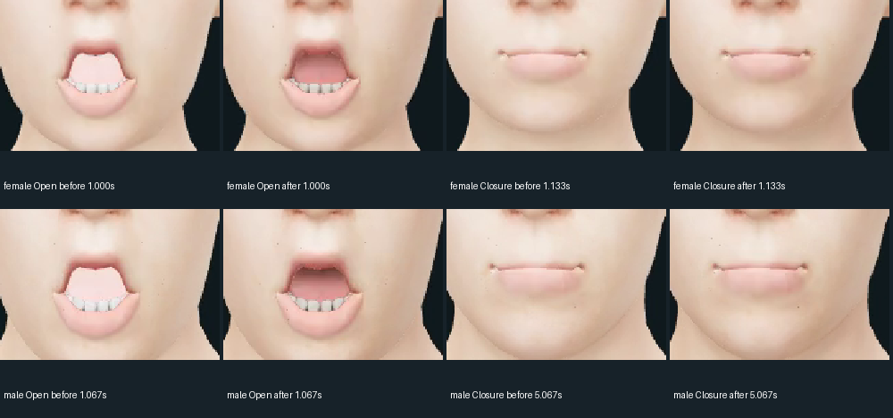

# MakeHuman mouth, lighting and fiber cleanup

## First visual-fix batch — 2026-10-17

This follows the [decoded-preview review](makehuman-visual-review.md).
WebGL surface version **physical-oral-skin-fibers-v3**:

- **Mouth:** diagnostic mesh isolation confirmed that the tongue contributes most
  of the bright pink area; hiding it also reveals a brightly lit inner body surface.
  The fix preserves geometry, morph targets, bones and viseme weights. It attenuates
  oral lighting by each vertex's rest-space front/back depth, carried through
  existing skinning/morphs: tongue 0.025–0.375, teeth 0.4–0.95. This is an explicit
  lightweight cavity-light **approximation**, not ray-traced AO, cast shadows or
  corrected tongue anatomy. Oral contact/placement still needs human review.
- **Teeth:** retain texture, use restrained linear ivory tint, roughness 0.38,
  specular intensity 0.2 and environment intensity 0.12 instead of bright white
  default illumination. Teeth and tongue stay visible; nothing is hidden to fake
  a darker cavity.
- **Skin lighting:** the soft preset previously used key/rim/fill intensities
  1.3/0.6/1.7. New values are 1.6/0.5/0.35, allowing more facial form instead of
  dominant fill. Studio is 1.8/0.75/0.5; dramatic 2.5/0.7/0.22. No darkening or
  recolouring of skin albedo. Existing skin detail/roughness controls are retained.
- **Brows/lashes:** known shared fiber materials get dark-brown rather than pure
  black response, roughness 0.88, specular intensity 0.05 and environment 0.12.
  This reduces fiber glints/contrast. **It does not replace sparse/coarse geometry**;
  stippling and silhouette limitations remain. Hair geometry is unchanged.

No new meshes, draw calls, shadow maps or additional textures relative to v2.
The oral attribute adds **18,988 bytes** for the prepared stock oral meshes
(4 bytes per vertex). Existing skin detail still uses one 128² RGBA texture
(65,536 base bytes / approximately 87,380 including mip levels); existing hair
requires tangent data. Unknown materials and unsuitable oral geometry fall back
without modification. `?surface=original` preserves original materials **and**
original lighting presets; that mode is not the preceding v2 renderer.

## Same-recording comparison, with strict identities

The comparison reuses the two **actual previously synthesized stock CPU WAVs**,
not newly generated audio and not non-speech fixtures. Same camera, exposure,
roughness controls, low LOD and 15 FPS fixed clock. Old encoded v2 movies provide
the before frames. New v3 movies provide after frames.

A changed viewer hash correctly invalidates old runtime session/rig bindings.
**No runtime checks were relaxed.** `tools/run_surface_replay.py` is an explicit,
developer-only comparison server limited to the **two checksum-pinned public
recordings** from the previous preview evidence. It validates source WAV/text/cues,
requires every rig field except viewer identity to stay identical, checks the
new viewer/model bytes, writes a fresh session with source-manifest/old-rig
provenance and validates the new binding. It refuses synthesis. It is **not** an
archive migration feature or permission to replay arbitrary old user sessions.
Metrics retained from the old session describe the original recording, not a new
speed benchmark. Back up user data and retain old builds for old archives.

Explicit developer flow (use original verified session directory):

```sh
.venv/bin/python tools/run_surface_replay.py --character female \
  --source-session ORIGINAL_FEMALE_SESSION_DIRECTORY \
  --assets artifacts/visual-fixes-female-studio \
  --sessions artifacts/visual-fixes-female-sessions --port 8084
# Server prints its fresh comparison_session ID. In a separate terminal:
JALI_PREVIEW_SESSION=PRINTED_COMPARISON_SESSION_ID \
  node tools/capture_talking_preview.cjs http://127.0.0.1:8084 artifacts/visual-fixes-female-preview
```

For the male use the male prepared studio, `--character male`, a different session
store/port and `JALI_PREVIEW_VOICE=am_michael`. Build the studios explicitly with
`build_neural_studio.py --output ...` (female) or additionally
`--character artifacts/male-character` (male). These environment-variable examples
use POSIX syntax; Windows PowerShell uses `$env:NAME='value'`.

Original WAVs are ignored session data, not committed assets. If those sessions
have been removed, the MP4's lossy AAC audio cannot recreate their exact WAV
hashes: make a **new baseline and after** comparison rather than claiming equivalence.

## Validation and remaining scope

Local **149 Python / 40 JavaScript tests pass**, including role allowlists, oral
attribute bounds/fallback, unchanged geometry/material texture/alpha contracts,
lighting fallback and rejection of non-viewer rig changes. Both actual shader movies completed: female **107 encoded frames / 7.104-second
WAV**, male **120 frames / 8.000-second WAV**. All **227 frame poses**, WAV/text hashes
and prepared low-LOD hashes match the original movies exactly. Full video/audio
decode and encoded counts were verified. Camera/exposure/roughness controls were
unchanged; numeric light intensities changed deliberately as described above.
[Exact comparison receipts](evidence/makehuman-visual-fixes-preview.json).
**All 12 hosted jobs passed** in [39021296279](https://github.com/Jacinth-19/Jali-Vulkan/actions/runs/39021296279),
source `60cb4f145f1e17abb53ac18fb90692244bfaf2c8`. This includes Windows offline
HTTP/file playback, stock frozen EXE rebuild/clean-PATH execution, unsigned
installer install/update/uninstall and hosted male asset/browser validation.
[Exact jobs, notices, first failure and scope](evidence/makehuman-visual-fixes-actions.json).
The custom male Windows EXE was not separately exercised; hosted male workspace
audio is an explicit non-speech fixture, unlike the actual recordings in the movies.

This is not a complete facial asset overhaul. Lip-corner/rounding geometry,
full-blink seal and F/V contact, better brow/lash/hair assets, authored skin detail,
physical AV, listening/human approval and measured i5-U/16 GB performance remain
open. No scanned skin, subsurface transport or full strand scattering is implied.
Appearance/video remain WebGL-only; native geometry/weights are unchanged.
Existing personal EXEs need rebuilding; signing remains optional. Default hosted
Windows packaging tests use the female asset, not a separate custom male EXE.

## Actual before/after renders




- [Updated female talking movie](media/makehuman-female-visual-fixes-talking.mp4)
- [Updated male talking movie](media/makehuman-male-visual-fixes-talking.mp4)

These are decoded real WebGL movies, not generated or retouched imagery. Comparison
labels/resizing/crops only. Sampled-frame review: less glaring oral pink/white and
more visible facial shading; central closure retained. The tongue/cavity still has
source-geometry limitations and brow/lash stippling is **not eliminated**. No final
human realism approval is inferred from the images.

The developer replay helper initially omitted its ready-job registry entry,
causing `loadExisting` to reject the freshly prepared comparison ID. The helper
registration was corrected and both complete captures then passed locally. This
is a comparison-tool fix, not a relaxation of runtime bindings or a shader change.

## Hosted cancellation-test regression and local confirmation

The first hosted run, [39020253681](https://github.com/Jacinth-19/Jali-Vulkan/actions/runs/39020253681)
(source `7f4c931`), finished **11 successful jobs / 1 failed job**. Windows offline
Chrome's cancellation check found an `ended` run rather than `cancelled`; the
reported full-mesh SwiftShader playback was approximately 1.73 FPS. The shader,
new speech, stock frozen EXE and unsigned installer checks in that run passed,
but the overall run is **not** counted as accepted.

The smoke test previously waited for a browser-protocol reply and then a separate
Playwright actionability/click round trip during a short clip. The corrected test
arms an in-page observation before starting playback, requires phase `playing`,
actual unpaused/unended audio with advancing time strictly inside the recording,
and invokes the **same Cancel or speed-change UI handler** immediately from that
observation. It still requires `cancelled` / `speed changed` and invalid samples;
end completion, startup cancellation, hash/no-network and report-integrity checks
are unchanged. Probe timestamps are retained. **No measurement validity or
performance threshold was weakened.** This tests handler semantics, not physical
input responsiveness on the target laptop.

Both HTTP and file:// checks passed locally with newly generated, verified stock
CPU recordings of the fixed public corpus; their live-action probes are retained
in the comparison receipt. Source `60cb4f1` includes this test correction and the
replay helper ready-job fix. WebGL code is byte-for-byte unchanged between
`7f4c931` and `60cb4f1`. The new full hosted run **39021296279 passed all 12 jobs**; the first failed run remains in the evidence.
