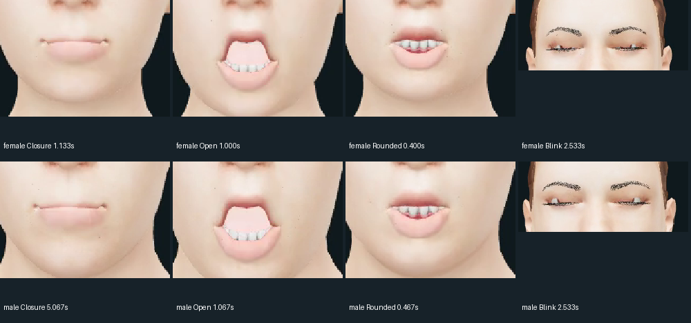

# Male/female talking-preview visual review

**2026-10-17 — sampled visual review, not final human acceptance.**

Reviewed decoded frames from the delivered female (107 frames, 7.104-second WAV)
and male (120 frames, 8.000-second WAV) videos, including rest, sampled blink peak,
strongest P/B/M, open-vowel and rounded-vowel controls. MP4 hashes were checked
against the original capture evidence; frames were decoded from the **encoded
movies**, not substituted renders. Original capture: 512×512 / 15 FPS, low LOD.
This is not a listening review, independent phoneme-alignment check, full temporal
artifact audit, rear/three-quarter assessment or physical AV measurement.

## Decision

**Not ready to call the faces realistic or visually finished.** Functional morphs
and successful automated tests are useful, but visible mouth-interior, skin,
brow/lash and hair limitations remain. Both characters share most of these issues.

*Actual video crops enlarged with nearest-neighbour sampling for inspection;
no retouching or generated imagery. Enlarged compression/low-LOD artifacts should
not be mistaken for independently measured geometry defects.*

## Findings and fix order

| Priority | Area | What is visible | Recommended next work, not implemented by this review |
|---|---|---|---|
| 1 — high | Open mouth / tongue / teeth | At female 1.000 s and male 1.067 s, a large, flat pink region occupies much of the mouth opening. The visible tooth row is very bright and regular, and the cavity lacks convincing depth. This is the most distracting speaking defect. | Inspect tongue, teeth and inner-mouth placement under the open-vowel morph; isolate meshes and inspect depth/occlusion before changing geometry. Improve cavity shading and tooth response. Frames alone do **not** identify the responsible mesh or prove a specific intersection. |
| 2 — high | Skin | Forehead and cheeks remain very pale, evenly lit and low in local variation. The overall result is still waxy/washed out despite procedural detail. | First compare key/fill/exposure and base-colour handling under controlled lighting; then improve authored colour/normal/roughness detail. Do not simply darken light skin or claim scanned pores/SSS. |
| 3 — high at portrait scale | Brows / eyelashes / eye contour | Brows look stippled/dotted; lashes form coarse dark, spiky outlines. They draw attention away from the eyes on both faces. | Check full-versus-low LOD, texture filtering, transparency/cutoff and geometry density. Improve brow/lash assets or their preparation before merely increasing shader complexity. |
| 4 — medium | Lip shaping | Strong P/B/M samples largely seal the centre, but the corners look pinched. At strong U controls, the mouth remains fairly wide/toothy rather than convincingly pursed. | Preserve working closure; tune corners and jaw/rounding combinations with isolated poses and a dedicated rounded-vowel utterance. These are estimated control samples, not verified phoneme timing. |
| 5 — medium | Hair | The front hairline is visibly coarse and the surface reads as broad shaded strips/cap-like rather than natural fine hair. | Improve the existing scalp/cards, alpha edges, texture variation and silhouette within the laptop budget. A distinct hairstyle is optional; long/shared hair does not invalidate the male shape. Rear ponytail quality is **not assessable** from these front views. |

### Eyelids: partial evidence, not a demonstrated full-closure failure

The sampled blink at **2.533 s** is near closed in both clips, with a coarse lash
line. No gross eye displacement is apparent in the selected frontal poses.
However, the maximum sampled blink weight is **0.848485**, not 1.0. At 15 FPS the
true continuous peak may fall between samples. We cannot certify full eyelid
closure or diagnose a full-blink gap from these frames. Next test an explicitly
held weight-1 closure and intermediate lid positions, plus gaze extremes.

### Lip closure: retain what works

Female **1.133 s** and male **5.067 s**, P/B/M control approximately **0.9975**:
the central lips appear closed in the selected frames. There is no obvious large
central opening there. The corners/seam still need refinement. This is not proof
that every P/B/M in either utterance is correctly timed or sealed.

### F/V contact: not covered

**Neither movie contains a nonzero `viseme_FF` sample in its recorded pose trace.**
The review therefore makes **no F/V contact pass/fail claim**. Use a dedicated
phrase with F/V sounds and inspect whether the lower lip meets the upper incisors.
Existing F/V support or historical fixtures elsewhere in the project do not make
these two clips an F/V acceptance test.

## Evidence and next acceptance test

- [Female overview](images/makehuman-review-female.png)
- [Male overview](images/makehuman-review-male.png)
- [Exact source video hashes, selected frame indices/times and coverage](evidence/makehuman-visual-review.json)
- [Original talking captures and rig/WAV identity](evidence/makehuman-skin-preview.json)

Recommended **first fix batch**: mouth-interior depth/visibility and tooth response,
then skin-lighting balance and brow/lash cleanup. Rerender the **same WAV, camera,
LOD and poses** for before/after comparisons; do not change everything at once.
Add held full blinks, isolated rounded/closure poses, an F/V utterance and
three-quarter hair views. Test the full asset as a diagnostic, but keep the low-LOD
path under review because it is the actual laptop-oriented preview configuration.

No runtime/material/rig changes were made for this review. Previous automated
acceptance remains the [d78fc3b hosted checkpoint](evidence/makehuman-skin-actions.json),
not a new visual-quality approval. User appearance/listening acceptance, physical
AV and target-i5 performance remain open. Appearance/video remain WebGL-only.
